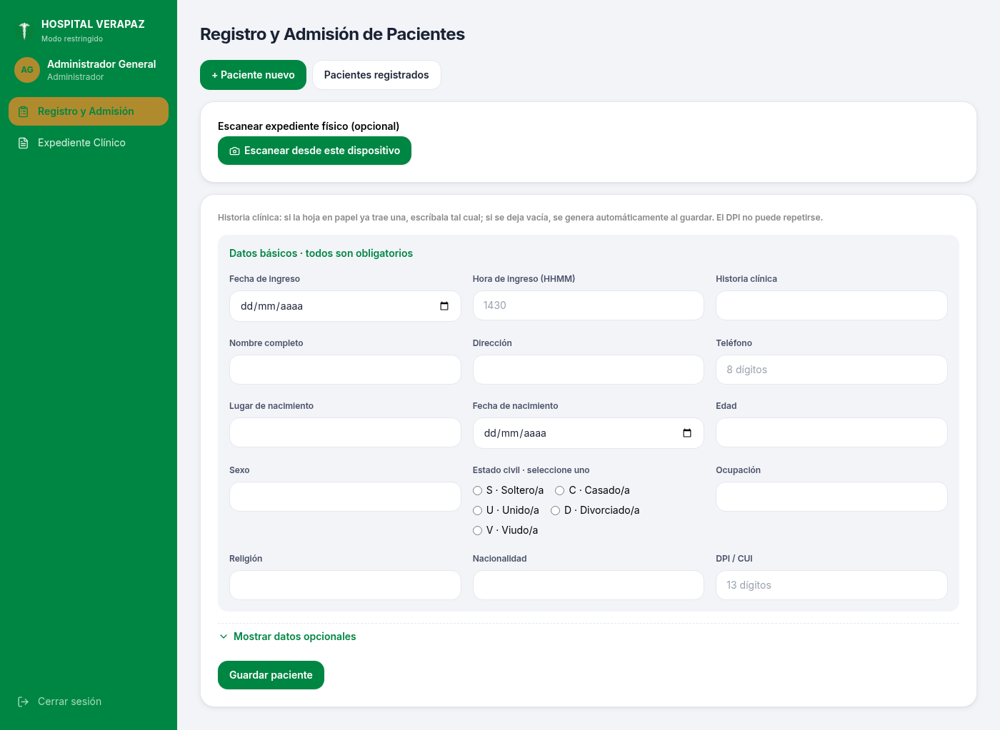
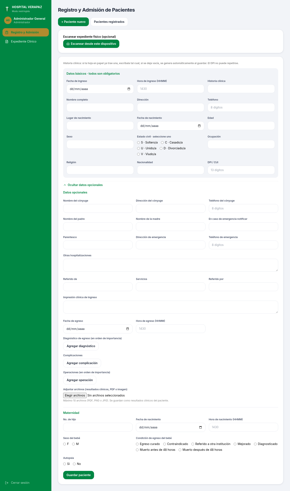
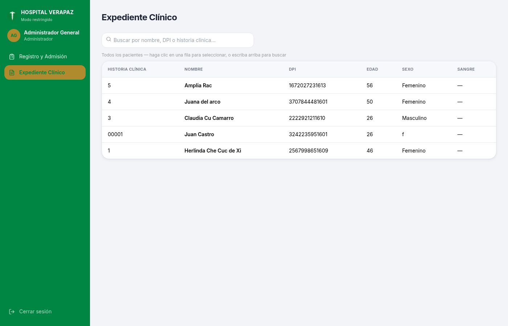
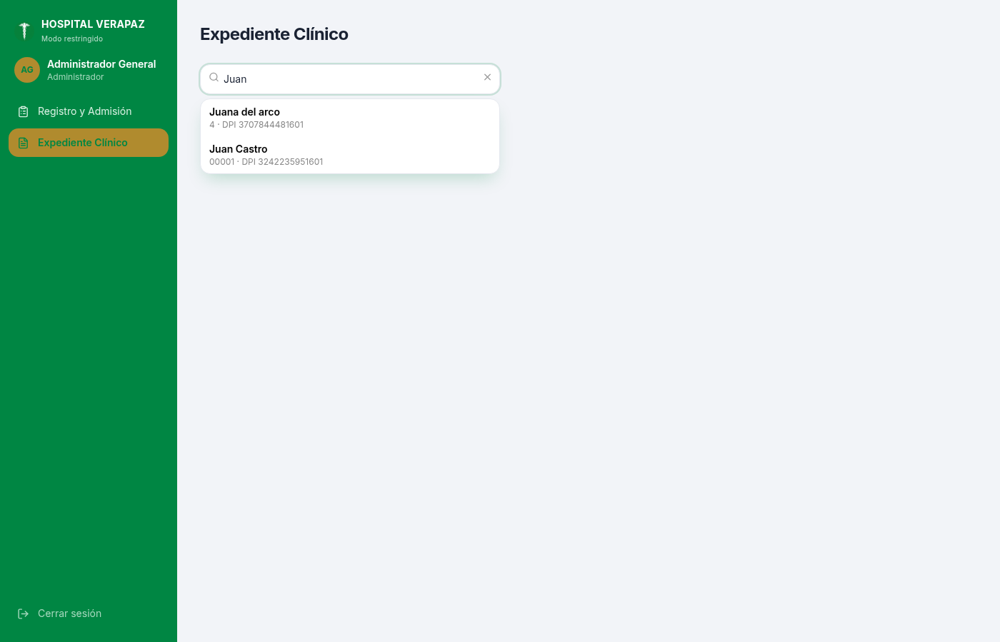
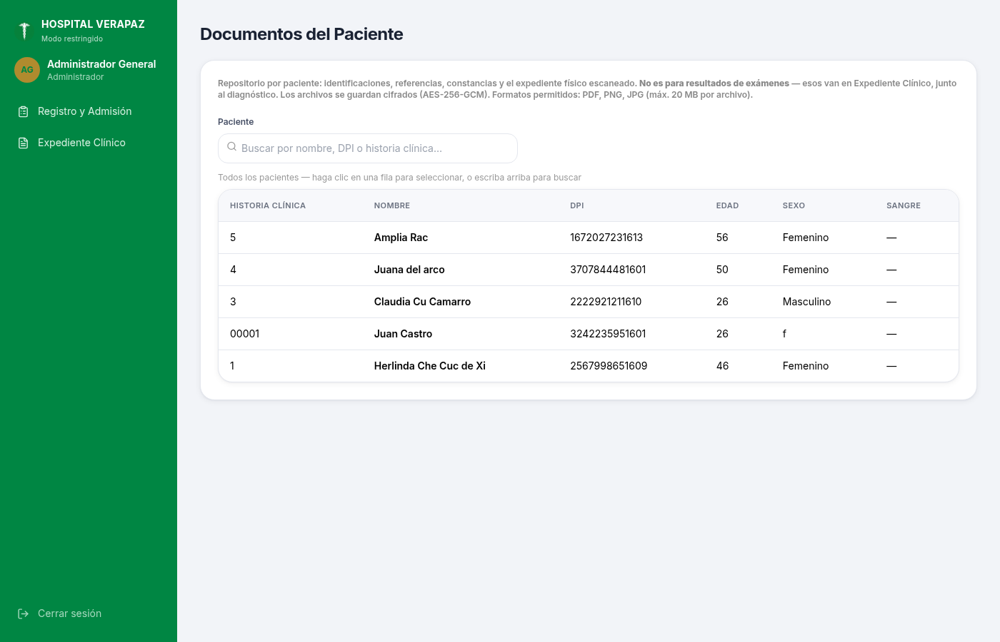
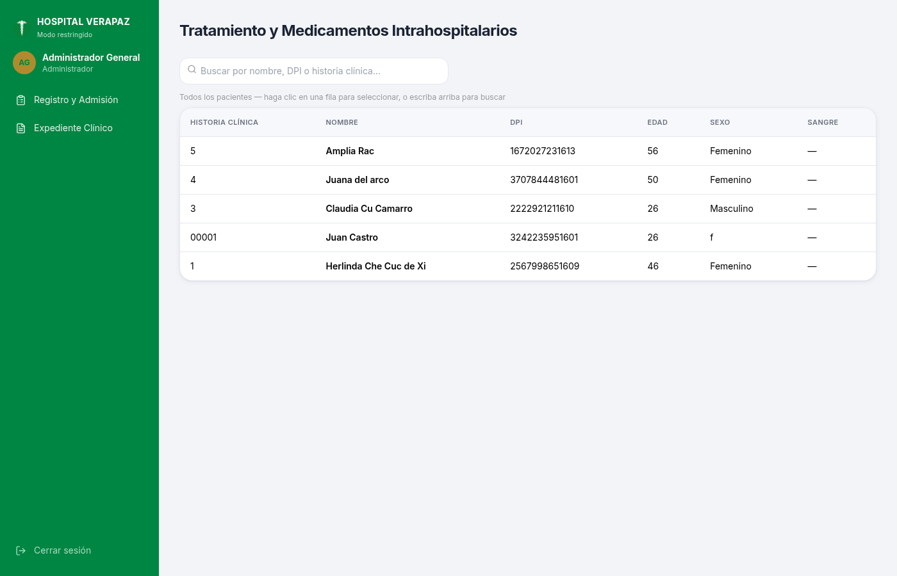
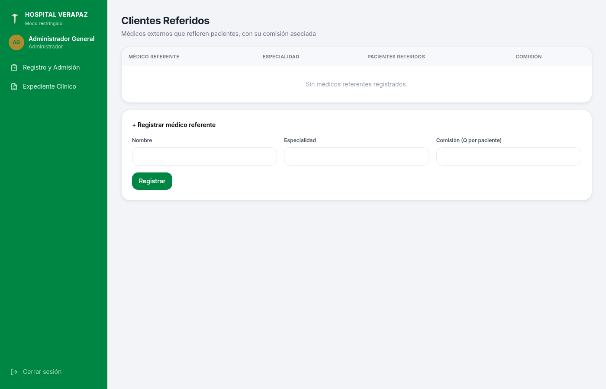
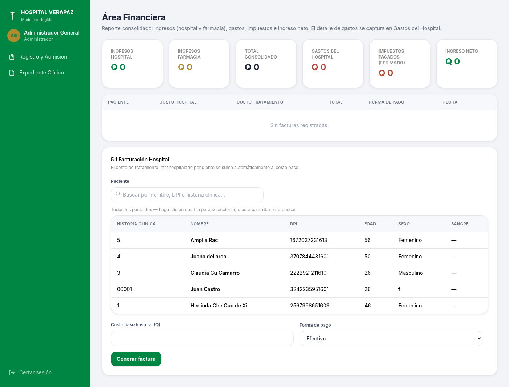
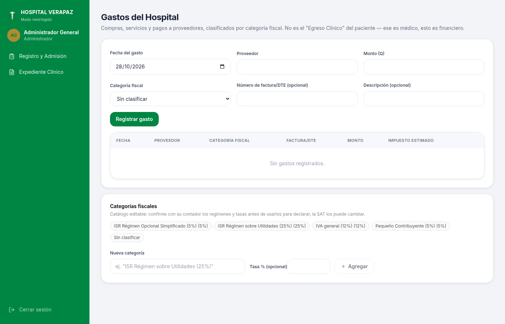
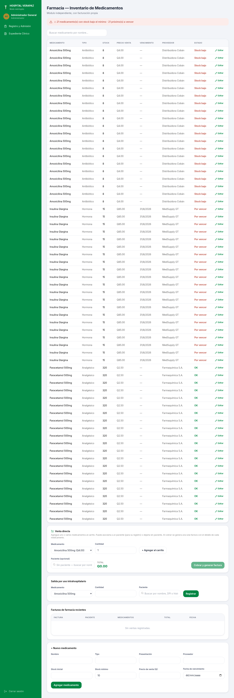

# Manual de Usuario — Sistema de Expediente Clínico y Administrativo

**Hospital de Especialidades Verapaz, Cobán, Alta Verapaz**

**Versión:** 1.0  
**Fecha:** Octubre 2026  
**Dirigido a:** Todo el personal que utiliza el sistema (Recepción, Enfermería, Médicos, Farmacia, Facturación, Administración)

## Índice

1. [Introducción](#1-introducción)
2. [Requisitos para usar el sistema](#2-requisitos-para-usar-el-sistema)
3. [Inicio de sesión](#3-inicio-de-sesión)
4. [Conociendo el sistema](#4-conociendo-el-sistema)
5. [Módulo: Registro y Admisión](#5-módulo-registro-y-admisión)
6. [Módulo: Expediente Clínico](#6-módulo-expediente-clínico)
7. [Módulo: Documentos del Paciente](#7-módulo-documentos-del-paciente)
8. [Módulo: Tratamiento](#8-módulo-tratamiento)
9. [Módulo: Clientes Referidos](#9-módulo-clientes-referidos)
10. [Módulo: Área Financiera](#10-módulo-área-financiera)
11. [Módulo: Gastos del Hospital](#11-módulo-gastos-del-hospital)
12. [Módulo: Farmacia](#12-módulo-farmacia)
13. [Módulo: Seguridad y Roles](#13-módulo-seguridad-y-roles)
14. [Módulo: Reportes](#14-módulo-reportes)
15. [Recomendaciones importantes](#15-recomendaciones-importantes)
16. [Glosario](#16-glosario)

## 1. Introducción

El Sistema de Expediente Clínico y Administrativo del Hospital de Especialidades Verapaz ha sido diseñado para digitalizar y organizar todos los procesos del hospital, desde el registro de pacientes hasta la facturación, farmacia, reportes y control de usuarios.

Este manual tiene como objetivo guiar al usuario paso a paso para que pueda utilizar el sistema de manera correcta, segura y eficiente.

## 2. Requisitos para usar el sistema

Para poder utilizar el sistema correctamente, se necesita lo siguiente:

- **Computadora o dispositivo** con conexión a internet.
- **Navegador web actualizado**: Se recomienda Google Chrome, Mozilla Firefox, Microsoft Edge o Brave.
- **Usuario y contraseña**: Proporcionados por el Administrador del sistema.
- **Permisos de cámara** (opcional): Solo si se va a escanear documentos con la cámara del equipo.
- **Conexión estable** a internet.

## 3. Inicio de sesión

### 3.1 Acceder al sistema

Para ingresar, abra su navegador web y escriba la dirección del sistema: **https://hospitalverapaz.com** (o la dirección que le haya proporcionado el administrador técnico).

### 3.2 Iniciar sesión con sus credenciales

1. En la pantalla de inicio, usted verá el formulario de acceso.
2. En el campo **Correo electrónico**, escriba el correo que le fue asignado.
3. En el campo **Contraseña**, escriba su contraseña.
4. Presione el botón **Ingresar**.

### 3.3 Cerrar sesión

Cuando termine de trabajar, siempre debe cerrar su sesión para proteger la información del hospital.

1. Diríjase al menú lateral izquierdo.
2. En la parte inferior, presione el botón **Cerrar sesión**.
3. Esto lo regresará automáticamente a la pantalla de inicio de sesión.

### 3.4 Recuperar contraseña

Si olvidó su contraseña:

1. En la pantalla de inicio de sesión, presione **¿Olvidó su contraseña?**
2. Ingrese su correo electrónico registrado y presione **Enviar**.
3. Revise su correo electrónico para obtener el enlace de recuperación.
4. Al abrir el enlace, ingrese y confirme su nueva contraseña.
5. Presione **Cambiar contraseña** para finalizar.

## 4. Conociendo el sistema

### 4.1 Menú lateral

Una vez dentro del sistema, encontrará el **menú lateral** ubicado en la parte izquierda de la pantalla. Este menú contiene todos los módulos a los que usted tiene acceso, dependiendo de su rol de usuario.

### 4.2 Barra superior y navegación

- **Módulos disponibles**: Solo se muestran los módulos permitidos para su rol.
- **Información de usuario**: En la parte superior del menú lateral aparece su nombre y rol asignado.
- **Cambio de módulo**: Para cambiar de módulo, simplemente haga clic en el nombre del módulo que desea abrir en el menú lateral.

## 5. Módulo: Registro y Admisión

El módulo **Registro y Admisión** es uno de los más importantes. Aquí se registran todos los pacientes que ingresan al hospital por primera vez.

### 5.1 Ver lista de pacientes registrados

Al entrar a este módulo, por defecto verá la pestaña **Pacientes registrados**, donde aparece una tabla con todos los pacientes ya registrados en el sistema.

En esta lista podrá ver: Historia Clínica, Nombre completo, DPI, Edad, Sexo, Tipo de sangre y Fecha de registro.

### 5.2 Buscar un paciente

Para encontrar rápidamente un paciente:

1. En la parte superior de la lista, encontrará el campo **Buscar por nombre, DPI o historia clínica**.
2. Escriba parte del nombre, número de DPI o número de historia clínica del paciente.
3. La lista se filtrará automáticamente mostrando solo los resultados que coincidan.
4. Si desea limpiar la búsqueda, presione la **X** que aparece dentro del campo de búsqueda.

### 5.3 Registrar un paciente nuevo

Para registrar un paciente que nunca ha estado en el hospital:

**Paso 1:** Presione el botón **+ Paciente nuevo** ubicado en la parte superior.

**Paso 2:** Llene todos los **datos básicos obligatorios** que aparecen en el formulario:

- Fecha de ingreso
- Hora de ingreso
- Historia clínica
- Nombre completo
- Dirección
- Teléfono
- Lugar de nacimiento
- Fecha de nacimiento
- Edad
- Sexo
- Estado civil
- Ocupación
- Religión
- Nacionalidad
- DPI/CUI

**Paso 3:** Presione el botón **Guardar paciente** para finalizar el registro.

### 5.4 Agregar datos opcionales

El sistema permite agregar información adicional si es necesaria:

1. En el formulario de registro, presione **Mostrar datos opcionales**.
2. Se desplegarán campos adicionales como: Responsable, Dirección del responsable, Teléfono del responsable, Tipo de sangre, Alergias, Antecedentes familiares, entre otros.
3. Llene únicamente los que considere necesarios.
4. Para ocultarlos nuevamente, presione **Ocultar datos opcionales**.

### 5.5 Escaneo de expediente físico

En la parte superior del formulario de paciente nuevo, aparece la opción **Escanear expediente físico (opcional)**. Esta opción permite escanear o tomar fotos del expediente en papel y guardarlo en formato PDF junto al paciente, sin modificar el documento original.

1. Presione **Escanear desde este dispositivo**.
2. Puede usar la cámara de su computadora o subir una imagen/PDF desde su equipo.
3. Siga las instrucciones del escáner para capturar las páginas.
4. Al finalizar, el PDF quedará adjuntado y se guardará al presionar **Guardar paciente**.

## 6. Módulo: Expediente Clínico

El módulo **Expediente Clínico** permite consultar toda la información médica del paciente, su historial de ingresos y los diagnósticos registrados por cada ingreso.

### 6.1 Buscar paciente en el expediente clínico

1. Seleccione **Expediente Clínico** en el menú lateral.
2. En el buscador, escriba el nombre completo, DPI o número de historia clínica del paciente.
3. Seleccione el paciente de la lista que aparece.
4. Inmediatamente se cargará toda la información de ese paciente.

### 6.2 Ver historial de ingresos

Una vez seleccionado el paciente, podrá ver la sección **Historial de ingresos**. Aquí se muestran todos los ingresos que ha tenido el paciente al hospital, con su fecha y hora.

Para cada ingreso aparecerán dos botones:

- **Ver diagnóstico** - Permite visualizar el diagnóstico registrado para ese ingreso (solo lectura).
- **Registrar diagnóstico / Editar diagnóstico** - Permite agregar o actualizar el diagnóstico de ese ingreso en específico.

### 6.3 Ver diagnóstico

1. Localice el ingreso del cual desea ver el diagnóstico.
2. Presione el botón **Ver diagnóstico**.
3. Se abrirá una ventana mostrando el diagnóstico completo en modo **solo lectura**. No podrá editarlo desde esta vista.

### 6.4 Registrar diagnóstico

1. Localice el ingreso al cual desea agregar un diagnóstico.
2. Presione el botón **Registrar diagnóstico**.
3. Se abrirá el formulario de diagnóstico.
4. Llene los campos correspondientes (motivo de consulta, signos vitales, examen físico, diagnóstico principal, etc.).
5. Presione **Guardar diagnóstico** para finalizar.

> **Importante:** Cada ingreso tiene su propio diagnóstico independiente. Un diagnóstico no se comparte entre diferentes ingresos del mismo paciente.

## 7. Módulo: Documentos del Paciente

Este módulo permite ver, descargar y administrar todos los documentos escaneados relacionados con el paciente.

**Funciones disponibles:**

- **Ver documento** - Abre el documento escaneado para visualizarlo.
- **Descargar documento** - Guarda una copia del documento en su computadora.
- **Eliminar documento** - Solo el personal autorizado puede eliminar documentos.

Para usarlo, primero debe buscar y seleccionar el paciente desde el buscador superior.

## 8. Módulo: Tratamiento

En el módulo **Tratamiento** se registra todo lo relacionado con la atención médica del paciente durante su hospitalización.

**¿Para qué se utiliza?**

- Registrar tratamientos médicos aplicados al paciente
- Llevar seguimiento a la evolución del paciente
- Registrar medicamentos administrados
- Mantener el control del tratamiento por ingreso

Para utilizarlo, debe seleccionar primero el paciente desde el buscador que aparece en la parte superior.

## 9. Módulo: Clientes Referidos

Este módulo sirve para llevar el control de los médicos, clínicas u otras instituciones que envían pacientes al Hospital Verapaz.

**Funciones:**

- **Agregar referido** - Registrar un nuevo médico o institución que refiere pacientes.
- **Ver lista de referidos** - Consultar todos los referidos registrados.
- **Control de comisiones** - Llevar seguimiento a las comisiones por paciente referido.

## 10. Módulo: Área Financiera

El módulo **Área Financiera** permite llevar el control de facturación del hospital.

**Funciones principales:**

- **Facturación** - Crear facturas para los pacientes.
- **Costeo** - Consultar el costo total del tratamiento por paciente.
- **Reportes financieros** - Visualizar ingresos, egresos y resumen financiero.
- **Seguimiento de pagos** - Controlar el estado de las facturas.

## 11. Módulo: Gastos del Hospital

Aquí se registran todos los gastos operativos del hospital para mantener un control financiero correcto.

**Pasos para registrar un gasto:**

1. Presione **Agregar gasto**.
2. Seleccione la fecha del gasto.
3. Elija la categoría del gasto.
4. Ingrese el monto y la descripción.
5. Presione **Guardar** para registrar el gasto.

## 12. Módulo: Farmacia

El módulo **Farmacia** controla el inventario de medicamentos, las entradas, salidas y ventas del departamento de farmacia.

### 12.1 Consultar inventario

En la pestaña **Inventario** podrá ver todos los medicamentos registrados con: nombre, stock actual, precio, fecha de vencimiento y proveedor.

### 12.2 Venta directa

1. Diríjase a la pestaña **Venta directa**.
2. Busque el medicamento que desea vender.
3. Agregue la cantidad al carrito.
4. Complete los datos de la venta.
5. Presione **Finalizar venta**.

### 12.3 Registrar entrada de medicamentos

Cuando llega nuevo medicamento a la farmacia:

1. Seleccione el medicamento o agregue uno nuevo.
2. Presione **Agregar entrada**.
3. Ingrese la cantidad, lote, fecha de vencimiento y proveedor.
4. Presione **Guardar**. El stock se actualizará automáticamente.

### 12.4 Alertas

El sistema muestra alertas automáticas cuando:

- **Medicamentos por vencer** - Próximos a caducar
- **Stock bajo** - Cuando la cantidad está por debajo del mínimo establecido

## 13. Módulo: Seguridad y Roles

**Únicamente el Administrador del sistema** puede acceder a este módulo. Es el encargado de controlar quién puede ingresar al sistema y qué permisos tiene cada usuario.

### 13.1 Crear un nuevo usuario

1. En la sección **Nuevo usuario**, llene: Nombre completo, Correo electrónico, Contraseña temporal.
2. En **Roles**, seleccione uno o varios roles según las funciones que tendrá el usuario.
3. Si el usuario es médico, podrá agregar su número de colegiado y especialidad.
4. Presione **Crear usuario**.

### 13.2 Asignar o cambiar roles

1. En la tabla de usuarios, busque el usuario al que desea modificar.
2. En la columna **Roles**, marque o desmarque los roles correspondientes.
3. Los cambios se guardan automáticamente.

### 13.3 Generar código para ver diagnósticos

Para que un médico o secretaria pueda ver diagnósticos confidenciales:

1. En la sección **Emitir token de acceso temporal**, seleccione el usuario.
2. Presione **Generar código**.
3. Copie el código generado y entregue al usuario por un canal seguro.
4. El código es de **un solo uso** y tiene tiempo de expiración.

> **Importante:** Solo el Administrador puede generar estos códigos. Los demás usuarios no pueden auto-generarlos.

## 14. Módulo: Reportes

El módulo **Reportes** permite generar diferentes tipos de reportes para el análisis y control del hospital.

### 14.1 Tipos de reportes disponibles

- **Reporte de ingresos** - Pacientes registrados por fecha.
- **Reporte financiero** - Facturación, pagos e ingresos del hospital.
- **Reporte de farmacia** - Movimientos de inventario, ventas y existencias.
- **Auditoría de accesos** - Registro de quién accedió a diagnósticos confidenciales y cuándo.
- **Bitácora de actividades** - Historial de acciones realizadas en el sistema.

### 14.2 Generar un reporte

1. Seleccione el tipo de reporte que desea consultar.
2. Elija el rango de fechas (desde / hasta).
3. Presione **Generar reporte** o **Consultar**.
4. El reporte se mostrará en pantalla con toda la información solicitada.

## 15. Recomendaciones importantes

- **Seguridad**: Siempre cierre su sesión al terminar, especialmente en computadoras compartidas.
- **Contraseñas**: No comparta su usuario ni contraseña con nadie.
- **Diagnósticos**: La información médica es confidencial. Solo acceda a ella cuando sea necesario.
- **Datos correctos**: Verifique siempre la información antes de guardar un paciente o diagnóstico.
- **Códigos de acceso**: Los códigos para ver diagnósticos son personales, de un solo uso y deben manejarse con cuidado.
- **Respaldos**: El sistema guarda toda la información automáticamente al presionar **Guardar**.
- **Navegador**: Use siempre una versión actualizada del navegador para un mejor funcionamiento.

## 16. Glosario

| Término | Significado |
|---|---|
| **Historia Clínica** | Número único que identifica al paciente dentro del hospital. |
| **DPI/CUI** | Documento Personal de Identificación / Código Único de Identificación. |
| **Ingreso** | Cada vez que el paciente ingresa al hospital se registra un ingreso nuevo. |
| **Diagnóstico** | Registro médico hecho por el doctor sobre la condición del paciente. |
| **Token/Código temporal** | Código de autorización para acceder a información médica confidencial. |
| **Factura** | Documento que detalla los cargos por los servicios recibidos. |
| **Stock** | Cantidad de medicamento disponible en farmacia. |
| **Lote** | Identificación del lote de medicamento para control de caducidad. |

**Elaborado para:** Hospital de Especialidades Verapaz  
**Sistema:** Expediente Clínico y Administrativo  
**Soporte:** Contactar al Administrador del Sistema
